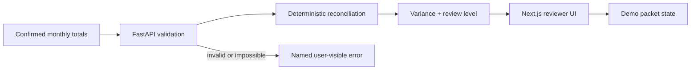

# Architecture

Frontend and backend consume `data/demo.json` for fixtures, thresholds, checklist, and disclaimer. The static Pages build runs the same pure arithmetic client-side; FastAPI is runnable source, not a deployed dependency.

Production separates untrusted extraction from the legal record: evidence → malware scan/hash → OCR suggestion → human confirmation → immutable ledger movement → reconciliation → second-person review → export. Nil, empty, invalid, and upstream-error paths remain visible and never create a packet.
